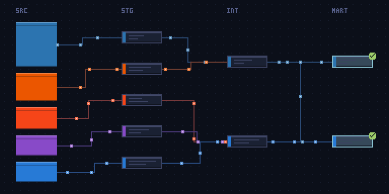
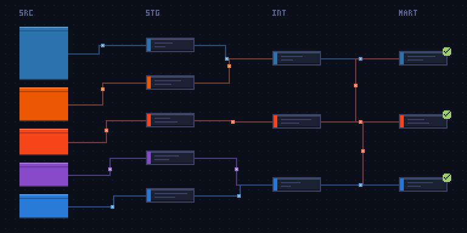

# Git lineage

Git lineage draws a GitHub account's public activity as a living, pixel-art dbt
lineage graph. Its languages become the sources, its contributions grow the
staging, intermediate, and mart layers, its streaks turn the marts' tests green,
and the day that just ended decides how data flows through the pipes. A nightly
workflow puts the graph on a profile README as a looping GIF, the same tool runs
from the command line, and a Rust library sits underneath.

<p align="center">
  
</p>

## How It Reads

- **Sources** are the account's leading languages, up to five, in GitHub's
  language colors and as tall as each language's share of its public projects.
- **Layers** grow with total contributions: sources feed marts directly at
  first, a staging model per source appears at 250 contributions, and an
  intermediate layer at 2,500. The intermediate and mart layers widen as the
  account keeps growing. The account's ID wires the graph, so its shape stays
  the same from day to day.
- **Flow** is the day's behavior, judged from the day that just ended:

  | Behavior  | When                                                  | What moves                                      |
  | --------- | ----------------------------------------------------- | ----------------------------------------------- |
  | Paused    | 60 or more quiet days                                 | Nothing; the graph greys and a cursor blinks    |
  | Idle      | 14 or more quiet days                                 | One packet trickles from a source to a mart     |
  | Ingest    | The first contribution of the week                    | Bursts leave pulsing sources                    |
  | Streaming | A contribution milestone, or a standout finished week | Dense packets on every pipe, the marts flashing |
  | Batch     | Any other day                                         | A wave crosses layer by layer, then lands       |

- **Streaks** put "tests passed" badges on the marts. They build over 13 weeks
  of a weekly streak and fade over six and a half weeks after it ends. The
  longest streak ever makes the language colors more vivid and, past a year,
  adds a green glow around the marts.

<p align="center">
  
</p>

## Repository Structure

```text
.
├── .github/      workflows, issue forms, and Dependabot
├── docs/         the getting-started guide and the README images
├── examples/     the profile workflow and the gallery generator
├── src/          the library and the git-lineage command
├── tests/        the public-boundary tests and their fixtures
└── action.yml    the GitHub Action
```

## Usage

### Requirements

- For a graph on your profile README: a GitHub account. The Action runs in your
  profile repository's workflow with its built-in token.
- For the command line: a binary from the
  [releases page](https://github.com/MarkPhamm/git-pixel-art/releases), or Rust
  at or above the `rust-version` in [Cargo.toml](Cargo.toml), plus the
  [GitHub CLI](https://cli.github.com), authenticated.
- For the library: Rust at or above that same version.

[docs/getting-started.md](docs/getting-started.md) walks through all three: the
Action in a profile workflow, the command line, and the library.

## Credits

Built on [git-koi](https://github.com/yalongwastaken/git-koi) by Anthony Yalong,
whose collection, history, behavior, and encoding pipeline this project keeps.

**Minh (Mark) Pham**

- GitHub: [@MarkPhamm](https://github.com/MarkPhamm)

## License

MIT. See [LICENSE](LICENSE).
